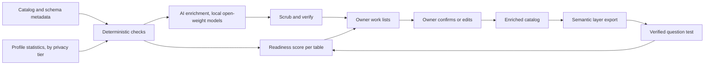

# Architecture

The pipeline reads metadata, scores it, drafts what's missing, routes drafts to owners, and publishes a semantic layer. Raw data stays where it is; sensitive steps run on owned hardware.

## Stages

| Stage | Input | Output | Runs where |
| --- | --- | --- | --- |
| 1. Collect | Data dictionary export or API, `information_schema`, query logs | Metadata snapshot | Anywhere |
| 2. Profile | Tables, by tier | Statistics only (tier B), nothing (tier C, D) | Secure environment |
| 3. Check | Snapshot plus profiles | Signal values per table and column | Anywhere; deterministic code (prototype in `scorer/`) |
| 4. Score | Signals | Level 0 to 4 per table, coverage per column | Anywhere |
| 5. Enrich | Metadata, allowed profiles | Draft descriptions and extracted rules, labeled unconfirmed | Secure environment, open-weight models |
| 6. Scrub | Drafts | Drafts with no personal values | Secure environment |
| 7. Route | Scores, drafts, usage | Ranked work list per owner | Anywhere |
| 8. Confirm | Owner decisions | Confirmed metadata | Catalog or a review screen |
| 9. Publish | Confirmed metadata | Semantic layer in each platform's format | Anywhere |
| 10. Test | Verified questions | Accuracy before and after | Each AI query tool |

## Design rules

- **Deterministic first.** Anything code can check, code checks.
- **AI drafts, people decide.** No AI output changes a score or reaches users until an owner confirms it.
- **Least data.** Each step sees the minimum its tier allows.
- **Portable output.** The semantic layer is exported as files, not locked into one platform.
- **Everything traceable.** Each field records its source: catalog, rule, AI draft, or owner.
